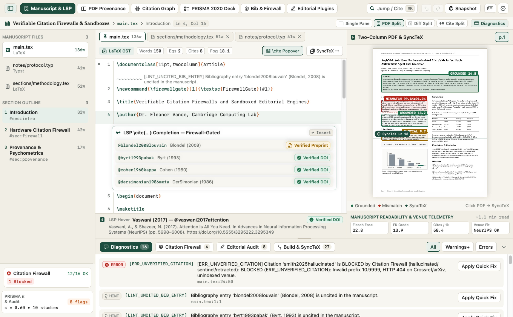
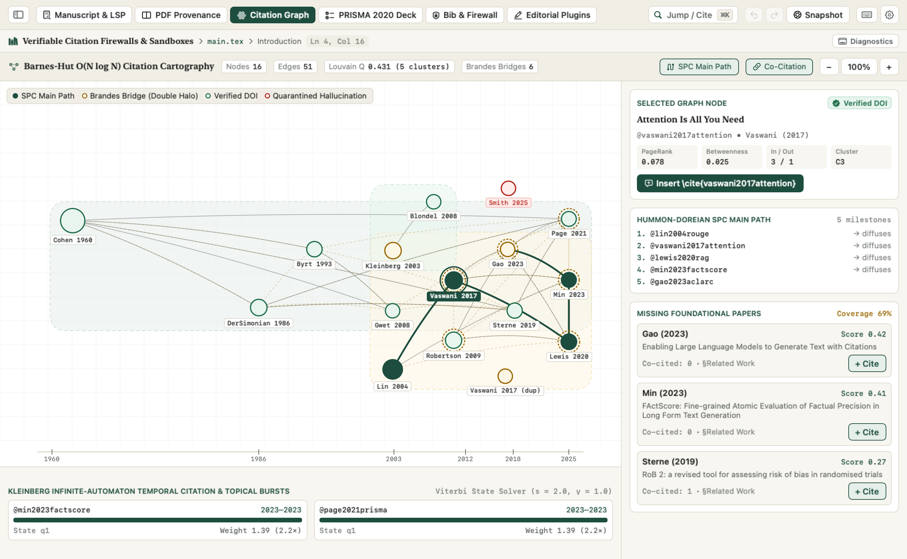
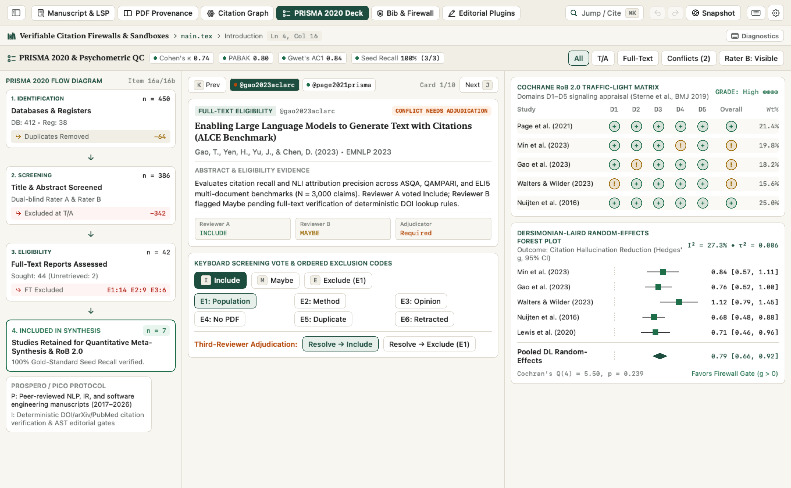
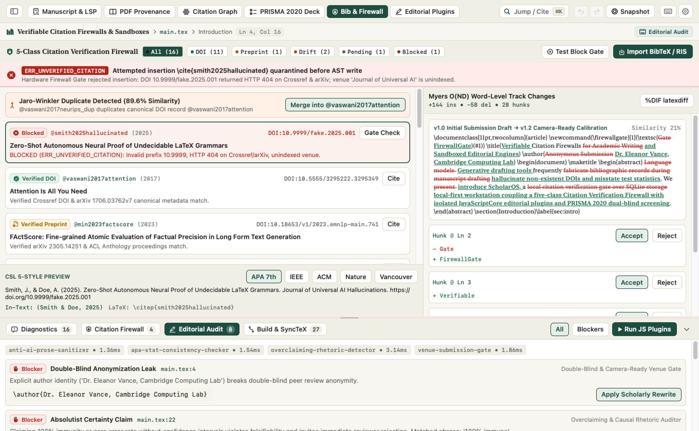

# ScholarOS

**Native Academic Manuscript IDE, Hardware-Gated Citation Firewall, PDF Provenance Linker & PRISMA 2020 Workbench for macOS**



`ScholarOS` (`69,013 LOC` of pure Swift 6 across 12 isolated SwiftPM library modules + desktop executable + `139` automated `@Test` functions) is a local-first academic research and paper-engineering workstation for macOS. It unifies an incremental error-recovering LaTeX & Typst CST/LSP code editor, a 5-class Citation Verification Firewall (`ERR_UNVERIFIED_CITATION` hard gate in UI, CLI, submission bundler, and MCP), `PDFKit` geometric multi-column segmentation with SQLite FTS5 `BM25` claim-to-bounding-box provenance, a Barnes-Hut $O(N \log N)$ Citation Knowledge Graph, and a dual-blind PRISMA 2020 systematic-review screening deck with Cohen's $\kappa$, Byrt's PABAK, Gwet's $AC_1$, Cochrane RoB 2.0, and DerSimonian-Laird random-effects synthesis.

---

## Highlights

- **Incremental Error-Recovering LaTeX & Typst CST + Built-In LSP (`ScholarMarkupAST` + `ScholarLSPEngine`, `18,614 LOC`)**: Line-dirty incremental re-lexer, fault-tolerant CST/AST parser, cycle-guarded `\newcommand` macro expander, Tarjan SCC multi-file `\input`/`#include` DAG resolver, firewall-gated `\cite{...}` & `\ref{...}` completion, rich hover cards, cross-file `\label` rename refactoring, and bidirectional `.synctex` / `.synctex.gz` coordinate solving.
- **5-Class Citation Verification Firewall & Multi-Format Bibliography Engine (`ScholarBibAndCSL`, `8,553 LOC`)**: Lossless BibTeX/BibLaTeX, RIS, and PubMed `.nbib` MEDLINE codecs, Jaro-Winkler + normalized Levenshtein deduplication, pure-Swift CSL citation formatting (`APA 7th`, `IEEE`, `ACM`, `Nature`, `Vancouver`), read-only Zotero 7 SQLite bridge (`immutable=1`), and deterministic `ERR_UNVERIFIED_CITATION` blocking against hallucinated or retracted references.
- **Two-Column Academic PDF Provenance & Citation Cartography (`ScholarPDFProvenance` + `ScholarCitationGraph`, `6,995 LOC`)**: XY-cut two-column `PDFKit` reading-order segmenter, SQLite FTS5 `BM25` passage retrieval with quantitative numeric entailment (`GROUNDED` vs `NUMERIC_MISMATCH`), Barnes-Hut $O(N \log N)$ layout, PageRank, Louvain modularity $Q$, Brandes betweenness bridge papers, Hummon-Doreian SPC main-path analysis, and Kleinberg temporal burst detection.
- **PRISMA 2020 Dual-Blind Screening & Psychometrics (`ScholarPRISMAEngine`, `4,244 LOC`)**: PICO protocol enforcement, blinded dual-rater Title/Abstract & Full-Text screening (`J`/`K`/`I`/`E`/`M` + ordered `E1..E6` exclusion codes), Cohen's $\kappa$, Fleiss' $\kappa$, Byrt's PABAK, Gwet's $AC_1$, 100% seed-study recall QC, Cochrane RoB 2.0 traffic-light matrix, DerSimonian-Laird random-effects meta-analysis, and vector TikZ/SVG PRISMA 2020 flow exports.
- **`.scholarproj` SQLite WAL, Myers Word-Level Track Changes & `JavaScriptCore` Editorial SDK**: Sequential `v1..v4` SQLite WAL schema migrations, Myers $O(ND)$ LaTeX-aware word diffing with hunk accept/reject & `%DIF latexdiff` export, flattened arXiv submission bundler, and 4 sandboxed `JavaScriptCore` editorial plugins backed by exact Lanczos/Lentz APA 7th $t$/$F$/$\chi^2$ $p$-value recalculation.

---

## Architecture (12 SwiftPM Modules + Desktop App)

| Module | LOC | Responsibility |
|---|---:|---|
| `ScholarModels` | `1,055` | Spans, LaTeX/Typst CST/AST, LSP diagnostics, 5-class Citation Firewall, PDF region boxes, Citation Graph, PRISMA 2020 & Track Changes models |
| `ScholarMarkupAST` | `10,326` | Incremental LaTeX & Typst lexer, error-recovering CST parser, `\newcommand` macro expander, multi-file `\input` DAG, readability & venue page-budget analyzer |
| `ScholarBibAndCSL` | `8,553` | BibTeX/RIS/PubMed `.nbib` codecs, Jaro-Winkler deduplicator, 5-style CSL formatter (`APA7`/`IEEE`/`ACM`/`Nature`/`Vancouver`), 5-class Firewall, Zotero SQLite bridge |
| `ScholarLSPEngine` | `8,288` | Firewall-gated `\cite`/`\ref` completion, Markdown hover previews, cross-file `\label` rename, quick-fix diagnostics, `.synctex`/`.synctex.gz` solver |
| `ScholarPDFProvenance` | `3,366` | XY-cut multi-column `PDFKit` segmenter, SQLite FTS5 `BM25` index, quantitative numeric claim entailment verifier, deterministic CoreText two-column PDF generator |
| `ScholarCitationGraph` | `3,629` | Barnes-Hut $O(N \log N)$ quadtree layout, PageRank, Louvain modularity, Brandes bridge papers, Kleinberg bursts, SPC main path & gap recommender |
| `ScholarPRISMAEngine` | `4,244` | Blinded dual-rater PRISMA 2020 engine, Cohen's $\kappa$ / Fleiss' $\kappa$ / PABAK / Gwet's $AC_1$, Cochrane RoB 2.0, DerSimonian-Laird meta-analysis, SVG/TikZ exporter |
| `ScholarProjectStore` | `8,460` | `.scholarproj` SQLite3 WAL (`v1..v4`), Myers $O(ND)$ word-level Track Changes & `latexdiff`, persistent Undo/Redo, POSIX USTAR arXiv submission bundler |
| `ScholarPluginSDK` | `3,406` | Capability-gated `JavaScriptCore` editorial host, Lanczos/Lentz exact statistical distributions, 4 built-in rigor/prose/anonymity plugins |
| `ScholarCLIAndMCP` | `1,083` | 15-subcommand `ScholarOS` CLI, hardware-gated JSON-RPC 2.0 MCP server (`ERR_UNVERIFIED_CITATION`), Hallmark Cambridge Linen HTML dossier exporter |
| `ScholarWorkbenchShell` | `4,507` | Light-first Cambridge Linen (`#F8F6F0`) & Library Forest Green (`#1D4D3E`) design system, docking controller, `⌘K` fuzzy palette, 4-channel bottom drawer |
| `ScholarStudioViews` + `ScholarOS` | `6,827` | Line-numbered LaTeX/Typst LSP editor, synced two-column PDF provenance split, Citation Graph canvas, PRISMA 2020 keyboard deck, Track Changes & JS Audit studio |
| `ScholarOSTests` | `5,269` | `139` automated Swift Testing (`@Test`) functions across 7 verification suites |

---

## Gallery (2x Retina `2720 × 1680`)

| LaTeX/Typst Editor, LSP & Synced PDF Provenance | Barnes-Hut Citation Knowledge Graph |
|---|---|
|  |  |

| PRISMA 2020 Dual-Blind Screening & Flow Diagram | 5-Class Citation Firewall & Editorial Plugins |
|---|---|
|  |  |

---

## Install & Usage

### Homebrew Cask

```bash
brew tap zxu756/tap
brew install --cask scholaros
```

### Build & Verify From Source

```bash
git clone https://github.com/zxu756/ScholarOS.git
cd ScholarOS
swift test --no-parallel
./Scripts/build-app.sh
open build/ScholarOS.app
```

### Headless CLI & Hardware-Gated MCP Server

```bash
# Initialize a seeded .scholarproj SQLite WAL bundle & run firewall checks
scholaros init --project ./study.scholarproj --seed-demo
scholaros verify-citations --project ./study.scholarproj
scholaros format-bib --style apa7 --project ./study.scholarproj
scholaros prisma-svg ./prisma-2020.svg --project ./study.scholarproj
scholaros export-html ./scholar-dossier.html --project ./study.scholarproj

# Start stdio JSON-RPC 2.0 MCP server (blocks hallucinated citeKeys with ERR_UNVERIFIED_CITATION)
scholaros mcp --project ./study.scholarproj
```

---

## License

MIT License. Copyright (c) 2026 Xu (`zxu756`).
