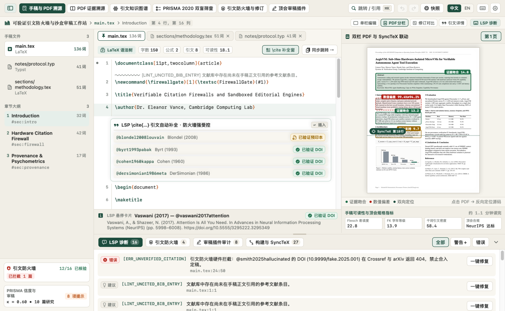
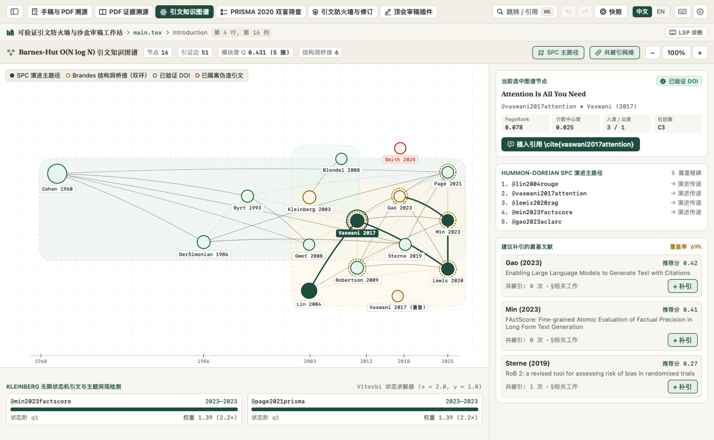
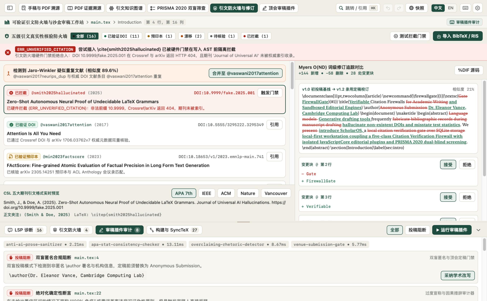

# ScholarOS

**[English](README.md)** | **简体中文**

**macOS 原生学术手稿 IDE · 硬件级引文核验防火墙 · PDF 框级证据溯源 · PRISMA 2020 双盲系统综述工作站（`v1.1.0`）**



`ScholarOS`（`v1.1.0` · 纯 Swift 6 编写，共 `70,558` 行代码，由 12 个独立 SwiftPM 核心模块、原生 macOS 桌面端及 `142` 项自动化 `@Test` 测试组成）是一款本地优先（Local-First）、原生支持**中英双语实时切换（`中文 / EN`）**的学术写作与科研工程工作站。它将增量容错 LaTeX / Typst 语法树与内置 LSP 编辑器、五级引文真实性核验防火墙（在 UI、CLI、投稿打包器与 MCP 服务端统一执行 `ERR_UNVERIFIED_CITATION` 硬阻断门禁）、基于 `PDFKit` 双栏几何切分与 SQLite FTS5 `BM25` 的论断级 PDF 坐标溯源、Barnes-Hut $O(N \log N)$ 引文知识图谱，以及支持 Cohen's $\kappa$、Byrt's PABAK、Gwet's $AC_1$、Cochrane RoB 2.0 偏倚风险评估与 DerSimonian-Laird 随机效应 Meta 分析的 PRISMA 2020 双盲文献筛查工作台融为一体。

---

## 核心特性

- **增量容错 LaTeX & Typst 语法树与内置 LSP 引擎（`ScholarMarkupAST` + `ScholarLSPEngine`，`18,614` 行）**：按行脏标记增量词法分析器、容错具体语法树（CST/AST）解析器、带环路检测的 `\newcommand` 宏展开器、基于 Tarjan 强连通分量的多文件 `\input` / `#include` 有向无环图解析、受引文防火墙门禁保护的 `\cite{...}` 与 `\ref{...}` 自动补全、悬停卡片、跨文件 `\label` 重命名重构，以及双向 `.synctex` / `.synctex.gz` 源码与 PDF 坐标求解。
- **五级引文真实性核验防火墙与多格式文献引擎（`ScholarBibAndCSL`，`8,553` 行）**：无损解析与序列化 BibTeX / BibLaTeX、RIS 与 PubMed `.nbib` MEDLINE 格式；结合 Jaro-Winkler 与归一化编辑距离识别疑似重复文献；内置纯 Swift CSL 五大主流期刊引文排版引擎（`APA 7th`、`IEEE`、`ACM`、`Nature`、`Vancouver`）；提供只读 Zotero 7 SQLite 桥接（`immutable=1`），并在写入语法树前对伪造或撤稿文献执行确定性 `ERR_UNVERIFIED_CITATION` 硬件级阻断。
- **双栏学术 PDF 框级证据溯源与引文知识图谱（`ScholarPDFProvenance` + `ScholarCitationGraph`，`6,995` 行）**：基于 XY-cut 的双栏学术 PDF 阅读顺序切分、SQLite FTS5 `BM25` 段落检索与定量数值蕴涵核验（自动区分 `证据吻合` 与 `数值偏差`）；内置 Barnes-Hut $O(N \log N)$ 四叉树力导向布局、PageRank 权威度、Louvain 模块度 $Q$ 聚类、Brandes 介数中心度结构洞桥接文献识别、Hummon-Doreian SPC 演进主路径提取与 Kleinberg 无限状态机引文突现检测。
- **PRISMA 2020 双盲文献筛查与心理测量信度质控（`ScholarPRISMAEngine`，`4,244` 行）**：内置 PROSPERO / PICO 审查方案约束、全键盘驱动双盲题摘初筛与全文复筛（`J`/`K`/`I`/`E`/`M` 快捷键与 `E1–E6` 有序排除编码）、Cohen's $\kappa$、Fleiss' $\kappa$、Byrt's PABAK、Gwet's $AC_1$ 一致性信度指标、100% 金标准种子文献召回质控、Cochrane RoB 2.0 五维偏倚风险交通灯矩阵、DerSimonian-Laird 随机效应森林图，以及一键导出矢量 SVG / LaTeX TikZ PRISMA 2020 四阶段流图。
- **`.scholarproj` SQLite WAL 工程包、Myers 词级修订追踪与 `JavaScriptCore` 顶会审稿插件 SDK**：支持 `v1..v4` 顺序可审计 SQLite WAL 架构迁移、保护 LaTeX 宏原子性的 Myers $O(ND)$ 词级修订对比（逐块接受/拒绝并导出可编译 `%DIF latexdiff` 源码）、自动展平 `\input` 并剔除注释的 arXiv 投稿归档打包器，以及基于隔离 `JavaScriptCore` 沙盒与 Lanczos/Lentz 精确分布重算 APA 7th $t$/$F$/$\chi^2$ $p$ 值的 4 款内置顶会审稿插件。
- **原生应用内中英双语实时切换（`v1.1.0`）**：顶部工具栏内置剑桥亚麻白与藏书馆森林绿配色的 `中文 | EN` 分段胶囊开关，配合菜单栏快捷键 `⇧⌘L`、偏好设置（`⌘,`）与命令行 `--lang zh|en` 参数，无需重启即可实时切换全部工作台、LSP 诊断卡片、引文图谱检查器、PRISMA 2020 流图与命令面板（`⌘K`）；当 macOS 系统首选语言为中文时自动默认启用简体中文界面，导出的独立 HTML 审计档案（`docs/demo-scholar-dossier.html`）亦内置交互式 `中文 | EN` 切换开关。

---

## 模块架构（12 个 SwiftPM 核心模块 + 原生桌面端）

| 模块 | 代码行数 | 核心职责 |
|---|---:|---|
| `ScholarModels` | `1,617` | 源码区间、LaTeX/Typst CST/AST、LSP 诊断、五级引文防火墙、PDF 坐标框、引文图谱、PRISMA 2020、修订追踪及 `ScholarLocalizer`（`中文 / EN` 双语引擎）领域模型 |
| `ScholarMarkupAST` | `10,326` | 增量 LaTeX 与 Typst 词法分析器、容错 CST 解析器、`\newcommand` 宏展开器、多文件 `\input` 依赖图、学术可读性与顶会篇幅预算分析器 |
| `ScholarBibAndCSL` | `8,553` | BibTeX/RIS/PubMed `.nbib` 编解码器、Jaro-Winkler 去重引擎、五大期刊 CSL 引文格式化（`APA7`/`IEEE`/`ACM`/`Nature`/`Vancouver`）、五级防火墙与 Zotero SQLite 只读桥接 |
| `ScholarLSPEngine` | `8,288` | 受防火墙门禁保护的 `\cite`/`\ref` 自动补全、悬停文献预览卡片、跨文件 `\label` 安全重命名、一键修复诊断与 `.synctex`/`.synctex.gz` 双向坐标求解 |
| `ScholarPDFProvenance` | `3,366` | XY-cut 双栏 `PDFKit` 版面切分、SQLite FTS5 `BM25` 全文检索索引、定量数值论断核验器、确定性 CoreText 双栏学术 PDF 生成器 |
| `ScholarCitationGraph` | `3,629` | Barnes-Hut $O(N \log N)$ 四叉树布局、PageRank、Louvain 模块度聚类、Brandes 结构洞桥接文献、Kleinberg 突现检测、SPC 演进主路径与缺引文献推荐 |
| `ScholarPRISMAEngine` | `4,244` | 双盲 PRISMA 2020 筛查状态机、Cohen's $\kappa$ / Fleiss' $\kappa$ / PABAK / Gwet's $AC_1$ 信度计算、Cochrane RoB 2.0、DerSimonian-Laird 随机效应森林图与矢量 SVG/TikZ 导出 |
| `ScholarProjectStore` | `8,460` | `.scholarproj` SQLite3 WAL 工程库（`v1..v4` 迁移）、Myers $O(ND)$ 词级修订对比与 `latexdiff` 生成、持久化撤销/重做日志、POSIX USTAR arXiv 投稿归档器 |
| `ScholarPluginSDK` | `3,406` | 权限受控的 `JavaScriptCore` 审稿插件宿主、Lanczos/Lentz 精确统计分布检验、4 款内置去 AI 套话/统计一致性/过度宣称/双盲匿名门禁插件 |
| `ScholarCLIAndMCP` | `1,310` | 含 15 个子命令的无头 `ScholarOS` CLI（支持 `--lang zh\|en`）、硬件级门禁 JSON-RPC 2.0 MCP 服务端（`ERR_UNVERIFIED_CITATION`）与双语剑桥亚麻风 HTML 审计报告导出器 |
| `ScholarWorkbenchShell` | `4,893` | 浅色优先剑桥亚麻（`#F8F6F0`）与森林绿（`#1D4D3E`）视觉设计系统、顶部 `中文 \| EN` 切换胶囊、多栏停靠控制器、`⌘K` 子序列模糊命令面板与四通道底部抽屉 |
| `ScholarStudioViews` + `ScholarOS` | `7,057` | 带行号 LaTeX/Typst LSP 编辑器、双栏 PDF 联动溯源分屏、引文知识图谱画布、PRISMA 2020 全键盘筛查台、词级修订对比与审稿插件工作台 |
| `ScholarOSTests` | `5,409` | 覆盖 7 大验证套件的 `142` 项 Swift Testing（`@Test`）自动化测试 |

---

## 界面预览（2x Retina 高清截图 `2720 × 1680`）

| LaTeX/Typst 手稿编辑器、内置 LSP 与双栏 PDF 证据溯源 | Barnes-Hut 引文知识图谱与 SPC 演进主路径 |
|---|---|
|  |  |

| PRISMA 2020 双盲文献筛查、RoB 2.0 与随机效应森林图 | 五级引文核验防火墙、词级修订对比与顶会审稿插件 |
|---|---|
|  |  |

---

## 安装与使用

### Homebrew Cask 一键安装

```bash
brew install --cask zxu756/tap/scholaros
```

或先添加软件源再安装：

```bash
brew tap zxu756/tap
brew install --cask scholaros
```

### 从源码编译与验证

```bash
git clone https://github.com/zxu756/ScholarOS.git
cd ScholarOS
swift test --no-parallel
./Scripts/build-app.sh
open build/ScholarOS.app
```

### 命令行工具（CLI）与硬件门禁 MCP 服务端

```bash
# 初始化带演示语料的 .scholarproj SQLite WAL 学术工程包并执行引文防火墙审计
scholaros init --project ./study.scholarproj --seed-demo
scholaros verify-citations --project ./study.scholarproj
scholaros format-bib --style apa7 --project ./study.scholarproj
scholaros prisma-svg ./prisma-2020.svg --project ./study.scholarproj
scholaros export-html ./scholar-dossier.html --project ./study.scholarproj

# 指定界面语言启动桌面端或导出 2x Retina 双语截图（--lang zh|en，亦支持环境变量 SCHOLAROS_LANG=zh）
scholaros --lang zh
scholaros --export-screenshots ./docs --lang zh

# 启动基于标准输入输出的 JSON-RPC 2.0 MCP 服务端（自动以 ERR_UNVERIFIED_CITATION 拦截伪造引文键）
scholaros mcp --project ./study.scholarproj
```

---

## 开源许可

MIT License. Copyright (c) 2026 Xu (`zxu756`).
